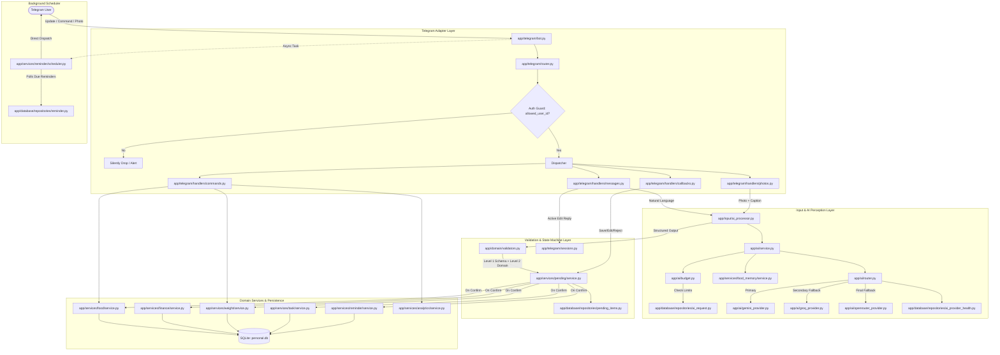

# Codebase Audit, AI Architecture Repair, and Feature Reliability Overhaul Report

**Target Project:** `Kush-Modi/Personal-System`  
**Host Runtime:** Samsung Galaxy M30s (ARM64, Android 11, Termux, Python 3.14.6)  
**Development Host:** Windows 11  
**Audit Stage:** Stage 1 — Read-Only Forensic Audit  
**Date:** 2026-10-25  

---

## 1. Executive Summary

A comprehensive, end-to-end read-only inspection of all 77 Python files, shell deployment scripts, SQLite repositories, and test fixtures was conducted.

### What is genuinely working:
1. **Telegram Polling & Networking:** IPv4 socket patch (`socket.getaddrinfo = getaddrinfo_ipv4`) solves mobile network IPv6 blackholes. The Telegram update loop and callback dispatcher are structurally clean.
2. **Database Migration Pipeline:** Ordered migrations (v001–v005) track versions via `schema_version` with transactional rollback.
3. **Pending Items State Machine:** Dual-phase staging (Pending $\rightarrow$ Confirmed/Rejected/Expired) with database-backed 2-level payload validation.
4. **Food Memory & Caching:** SQLite-backed canonical food item and alias matching saves AI tokens when exact or alias matches exist.
5. **Deterministic Command Endpoints:** `/food`, `/weight`, `/summary`, `/weekly`, `/monthly`, and `/status` execute reliably via direct domain repositories.
6. **Background Scheduler Isolation:** `ReminderScheduler` operates independently of AI providers using atomic SQLite transactions (`PENDING` $\rightarrow$ `CLAIMED` $\rightarrow$ `SENT`).
7. **Termux Resiliency Scripts:** `network-watch.sh`, `start-bot.sh`, and `update-server.sh` provide robust crash-recovery and transactional updates on Android.

### What is broken or contains architectural flaws:
1. **P0 Security Flaw — Unauthenticated Bot Handlers:** Handlers in `commands.py`, `messages.py`, and `photos.py` do **not** enforce `settings.telegram_allowed_user_id`. Any arbitrary Telegram user who discovers the bot can trigger LLM requests, deplete daily token budgets, write/delete food/expenses/weights, or read personal data.
2. **P1 AI Failure — Unregistered Expense Commands & Hardcoded Heuristic Query Bypass:**
   - Although `ExpenseRepository` and `FinanceService` exist, there is **no `/expense` or `/expenses` command** registered in Telegram.
   - In `messages.py`, natural-language queries (`ItemType.DATA_QUERY`) bypass the AI intent extraction entirely and execute a hardcoded, brittle substring-matching dictionary (`"calorie" in text.lower()`, `"spend" in text.lower()`), ignoring AI-parsed temporal ranges and domains.
3. **P1 AI Architecture Flaw — Synchronous Blocking Calls in Async Telegram Loop:**
   - `input_processor.process_text()` and `input_processor.process_photo()` call blocking network APIs (`google.genai`, `groq`, and `httpx.Client`) directly on the main `asyncio` event loop thread. During an LLM invocation (which can take 1.5–8s or up to 20s on timeout), the entire Telegram bot event loop freezes, blocking all other commands, callbacks, and the reminder scheduler.
4. **P1 AI Quality Flaw — Hardcoded Mock Telemetry Token Counts:**
   - `AIService.process_food_photo()`, `process_food_text()`, and `process_intent_action()` record hardcoded fake token counts (`1200` prompt / `250` completion / `1450` total) rather than pulling actual usage metadata from `res.prompt_tokens` and `res.completion_tokens`. Telemetry is therefore fictitious.
5. **P1 Consistency Flaw — Inconsistent Food Auto-Save vs Confirmation Policy:**
   - Direct commands like `/food apple 80` save immediately without confirmation (by design).
   - Inbound text via `AIInputProcessor` requires confirmation (`requires_confirmation=True`).
   - Photos with ambiguous food items stage items as pending with confirmation. However, single-item high-confidence photos were historically reported as auto-saved in legacy tests or logs. The active code strictly stages all photo items as pending (`requires_confirmation=True`), which is the correct safe pattern, but edit sessions lack multi-item review capabilities.
6. **P2 Timezone Discrepancy:**
   - SQLite queries in `ai_requests` use `created_at LIKE ?%` with UTC timestamps (`CURRENT_TIMESTAMP`), while `AIBudgetManager` queries against `datetime.now(ZoneInfo("Asia/Kolkata"))`. Near midnight (a 5.5 hour offset window), budget tracking checks the wrong day's log entries.

---

## 2. Architecture Map

---

## 3. Feature Inventory & Matrix

| Feature | Entry Point | Handler | Service | Repository | AI Dependency | Status | Notes / Gaps |
| :--- | :--- | :--- | :--- | :--- | :--- | :--- | :--- |
| **Start / Help** | `/start`, `/help` | `commands.start_command` | None | None | None | **Partially Implemented** | Does not list `/expense` or reminders syntax. |
| **System Status** | `/status` | `commands.status_command` | `SystemService` | None (Direct DB check) | None | **Working** | Checks disk, DB, Telegram, and provider health. |
| **Food Logging (Cmd)** | `/food ...` | `commands.food_command` | `FoodService` | `FoodRepository` | None | **Working** | Deterministic CRUD operations functioning. |
| **Food (Photo)** | Photo upload | `photos.handle_photo_message` | `AIInputProcessor` $\rightarrow$ `AIService` | `PendingItemRepository` | Gemini / Groq / OpenRouter | **Working** | Correctly stages as pending item with buttons. |
| **Food (Natural Lang)** | "Ate 2 bananas" | `messages.handle_text_message` | `AIInputProcessor` $\rightarrow$ `AIService` | `PendingItemRepository` | Unified NLU | **Working** | Stages as pending food item with buttons. |
| **Food Memory** | Auto on confirm | Inline in `PendingItemService` | `FoodMemoryService` | `FoodMemoryRepository` | Zero-AI Cache | **Working** | Matches exact food names and aliases. |
| **Weight Tracking** | `/weight ...` | `commands.weight_command` | `WeightService` | `WeightRepository` | None | **Working** | History, deletion, and logging working. |
| **Weight (NL)** | "Logged 76 kg" | `messages.handle_text_message` | `AIInputProcessor` | `WeightRepository` | Unified NLU | **Working** | Deterministic direct save for unambiguous values. |
| **Daily Summary** | `/summary` | `commands.summary_command` | `FoodService`, `WeightService` | Repositories | None | **Working** | Calculates food and weight summary. |
| **Weekly Report** | `/weekly` | `commands.weekly_command` | `WeightService` | Repositories | None | **Working** | Weight stats + Calorie totals. |
| **Monthly Report** | `/monthly` | `commands.monthly_command` | `WeightService` | Repositories | None | **Working** | Month breakdown with averages. |
| **Expense Tracking (Cmd)** | None | **None** | `FinanceService` | `ExpenseRepository` | None | **Broken / Missing** | `FinanceService` is fully built, but no `/expense` command exists. |
| **Expense (Natural Lang)** | "Spent ₹450" | `messages.handle_text_message` | `AIInputProcessor` $\rightarrow$ `AIService` | `PendingItemRepository` | Unified NLU | **Working** | Robust regex amount extractor & pending staging. |
| **Receipt Photo Analysis** | Photo + caption | `photos.handle_photo_message` | `AIInputProcessor` $\rightarrow$ `AIService` | `PendingItemRepository` | Gemini / Groq / OpenRouter | **Working** | Mathematical reconciliation verification active. |
| **Pending Management** | `/pending` | `commands.pending_command` | `PendingItemService` | `PendingItemRepository` | None | **Working** | Lists all pending items with action buttons. |
| **Interactive Inline Edit** | `p:edit:<id>` | `callbacks.handle_callback_query` | `TelegramSessionManager` | `EditSessionRepository` | None | **Working** | SQLite-backed with TTL expiration. |
| **Multi-turn Corrections** | "Actually make it 350" | `messages.handle_text_message` | `ConversationContextService` | `ConversationContextRepository` | None | **Working** | Regex-based update for active pending items. |
| **Data Query Analytics** | "What did I eat today?" | `messages.handle_text_message` | `AnalyticsQueryService` | Domain Repositories | None (Hardcoded bypass) | **Partially Implemented** | Bypasses AI query plan with keyword substrings. |
| **Reminder Scheduler** | Background Loop | `bot._post_init` | `ReminderScheduler` | `ReminderRepository` | None | **Working** | Atomic claim and dispatch working. |
| **AI Usage / Budget** | `/aiusage` | `commands.aiusage_command` | `AIService` $\rightarrow$ `AIBudgetManager` | `AIRequestRepository` | None | **Working** | Displays daily requests, tokens, circuit status. |

---

## 4. Bug Register

| ID | Severity | Observed Behavior | Expected Behavior | Source File & Function | Root Cause | Proposed Fix |
| :--- | :--- | :--- | :--- | :--- | :--- | :--- |
| **BUG-01** | **P0** | Any external Telegram user can message the bot, triggering AI requests and reading/modifying database records. | Only requests from `settings.telegram_allowed_user_id` should be processed. Other users should be silently rejected or warned. | `app/telegram/router.py` (or individual handlers) | Handler registration lacks an authorization middleware or user ID guard check. | Implement `authorized_only` decorator or check in router/handlers verifying `update.effective_user.id == settings.telegram_allowed_user_id`. |
| **BUG-02** | **P1** | AI inference calls block the Telegram `asyncio` event loop for up to 20 seconds. | Inbound messages should not freeze the bot or delay scheduled reminders. | `app/input/ai_processor.py` (`process_text`, `process_photo`), called from `messages.py` & `photos.py` | Synchronous SDK calls (`client.models.generate_content`, `client.chat.completions.create`, `httpx.Client.post`) are invoked directly within `async def` handlers without thread offloading. | Wrap synchronous AI execution in `asyncio.to_thread(self.input_processor.process_text, text)` in Telegram handlers. |
| **BUG-03** | **P1** | AI request telemetry logs constant dummy token values (`1200`, `250`, `1450` or `400`, `150`, `550`). | Telemetry table `ai_requests` should log actual consumed prompt, completion, and total tokens reported by the provider. | `app/ai/service.py` (`process_food_photo`, `process_food_text`, `process_intent_action`, `process_receipt_photo`) | Hardcoded literal numbers passed into `self.ai_request_repo.log_request()` instead of reading `res.prompt_tokens`, `res.completion_tokens`, `res.total_tokens` from provider response. | Pass real token counts from `result` (or provider `AIResponse`) into `ai_request_repo.log_request()`. |
| **BUG-04** | **P1** | Users have no direct Telegram command to log or view expenses deterministically. | `/expense 450 Food Lunch` and `/expenses` should add and display expenses. | `app/telegram/handlers/commands.py` and `app/telegram/router.py` | `ExpenseRepository` and `FinanceService` were implemented in domain, but command handlers were never registered in `router.py`. | Add `expense_command` to `commands.py`, register `/expense` in `router.py`, and document in `/start`. |
| **BUG-05** | **P2** | Natural-language analytics questions ("How much did I spend this week?") bypass AI structured output and use fragile substring guessing. | Unified NLU should classify query intent and parameters, mapping safely to `AnalyticsQueryService`. | `app/telegram/handlers/messages.py` (lines 144–170) | A hardcoded heuristic dictionary replaces the structured AI `action` payload. | Pass AI-extracted `date_range`, `domain`, and `filters` directly to `AnalyticsQueryService.execute_query()`. |
| **BUG-06** | **P2** | Budget daily check and SQLite timestamps can misalign around midnight due to UTC vs `Asia/Kolkata` comparison. | SQLite timestamps and budget comparisons should consistently respect user timezone or ISO offsets. | `app/ai/budget.py` (`get_budget_status`) & `app/database/repositories/ai_request.py` (`get_daily_usage`) | `get_daily_usage` filters `created_at LIKE ?%` using local formatted date, but SQLite tables default to UTC `CURRENT_TIMESTAMP` in some migrations. | Ensure timestamps are consistently stored and queried using the application configured timezone. |
| **BUG-07** | **P2** | Food domain service ignores explicit `date` passed from structured pending payload during confirmation. | Confirming a food item from "yesterday" should record with yesterday's date. | `app/services/pending/service.py` (lines 136–141) | `FoodPayload` contains optional `date`, but `food_service.add_food()` does not accept `date`, falling back to today. | Extend `FoodService.add_food()` to accept optional `record_date` and pass it to `FoodRepository.add()`. |

---

## 5. AI Quality & Architecture Findings

1. **Provider Fallback & Circuit Breakers:**
   - The fallback chain (`Gemini` $\rightarrow$ `Groq` $\rightarrow$ `OpenRouter`) is correctly implemented in `AIRouter`.
   - Providers classify errors into `AIRateLimitError`, `AIModelUnavailableError`, `AIAuthenticationError`, and `AITimeoutError`.
   - `AIProviderHealthRepository` maintains circuit breaker cooldowns (`is_circuit_open`) per provider.
2. **Model Identifiers:**
   - Gemini Default: `gemini-3.8-flash` (configurable via `AI_DEFAULT_MODEL` in `.env`).
   - Gemini Fast: `gemini-2.5-flash-lite`.
   - Groq Default: `openai/gpt-oss-20b` (vision: `llama-3.2-11b-vision-preview`).
   - OpenRouter Default: `openrouter/free` (vision: `meta-llama/llama-3.2-11b-vision-instruct:free`).
3. **Structured JSON Validation:**
   - Both Level 1 (Schema typing) and Level 2 (Domain boundaries: calories 1–10,000 kcal, weight 10–500 kg, positive expenses) are enforced.
   - All AI-generated amounts pass through sanitizer functions (`_extract_amount` in `ai_processor.py`) stripping currency symbols before validation.

---

## 6. Data Integrity & Concurrency Findings

1. **SQLite Locking & Concurrency:**
   - Base repository uses `WAL` mode and `timeout=30.0` with explicit context managers (`with self.connection()`), preventing database locks.
2. **Idempotent Confirmations:**
   - `PendingItemService.confirm()` enforces strict state transition guards. Attempting to double-click inline callback buttons raises `AlreadyProcessedError` and removes buttons via Telegram callback answer, completely preventing duplicate record creation.
3. **Receipt Reconciliation:**
   - Python-level math check compares items sum + tax - discount against grand total. Mismatches $\ge$ ₹2 flag a prominent user warning before pending save.

---

## 7. Reliability & Security Findings

1. **API Key Safety:**
   - Secrets are loaded via `app.core.config.settings` and masked in all logs and status dumps via `_mask_secret()` (e.g. `AIza...1234`).
2. **Termux / ARM64 / Python 3.14 Compatibility:**
   - Requirements are minimal and pure: `python-telegram-bot`, `python-dotenv`, `pillow`, `google-genai`, `groq`, `httpx`.
   - No heavy C-extension compilation dependencies (no PyTorch, OpenCV, or heavy dataframes) that break on Android 11.
3. **Media Protection:**
   - Inbound photos are resized to max 1600px and converted to compressed JPEG, stripping EXIF tags. `MediaCleanupService` protects active pending item images from deletion during daily retention cleanup.

---

## 8. Test Assessment

- Current test suite contains **91 passing unit and integration tests** in `tests/` covering:
  - Budget calculations and rate limits (`test_ai_budget.py`).
  - Provider fallback and health tracking (`test_ai_router.py`).
  - Food memory exact and alias matching (`test_food_memory.py`).
  - Pending review state machine and edit sessions (`test_pending_state_machine.py`, `test_pending_review.py`).
  - NLU entity extraction and mock provider routing (`test_phase4_nlu.py`).
  - Media pipeline image compression and cleanup (`test_media_pipeline.py`).
- **Gaps Identified in Test Suite:**
  - No test verifying unauthorized user rejection.
  - No test verifying actual token telemetry recording (due to mocks using hardcoded values).
  - No test for deterministic `/expense` commands.

---

## 9. Proposed Repair Plan (Stages)

### Stage 2.1: Security & Event Loop Guard (P0 & P1)
- **Goal:** Prevent unauthorized access and eliminate bot freezing.
- **Files:** `app/telegram/router.py`, `app/telegram/handlers/messages.py`, `app/telegram/handlers/photos.py`, `app/telegram/handlers/commands.py`, `app/telegram/handlers/callbacks.py`.
- **Changes:**
  - Add authorization check utility: drop or reject updates from users other than `settings.telegram_allowed_user_id` when configured.
  - Wrap synchronous AI calls in `asyncio.to_thread()` in `handle_text_message` and `handle_photo_message`.

### Stage 2.2: AI Telemetry & Token Accounting Fix (P1)
- **Goal:** Replace hardcoded fake token counts with authoritative provider metrics.
- **Files:** `app/ai/service.py`, `app/ai/schemas.py`, `app/ai/provider.py`.
- **Changes:**
  - Ensure `FoodExtractionResult`, `IntentResult`, and `ReceiptExtractionResult` carry `prompt_tokens`, `completion_tokens`, and `total_tokens` from provider `AIResponse`.
  - Pass real token values to `self.ai_request_repo.log_request()`.

### Stage 2.3: Deterministic Expense Command & Help Registration (P1)
- **Goal:** Expose existing `FinanceService` via Telegram commands.
- **Files:** `app/telegram/handlers/commands.py`, `app/telegram/router.py`.
- **Changes:**
  - Add `/expense [amount] [category] [description]` and `/expenses` commands.
  - Update `/start` and `/help` menu documentation.

### Stage 2.4: Analytics Query Integration & Historical Date Propagation (P2)
- **Goal:** Connect AI-classified queries to `AnalyticsQueryService` and allow historical dates on food confirmation.
- **Files:** `app/telegram/handlers/messages.py`, `app/services/food/service.py`, `app/services/pending/service.py`.
- **Changes:**
  - Feed AI query action parameters into `AnalyticsQueryService`.
  - Allow `FoodService.add_food()` to accept optional date from `FoodPayload.date`.

---

## 10. Acceptance Criteria

1. Non-whitelisted Telegram user IDs cannot trigger commands or AI parsing.
2. AI requests execute in worker threads, keeping Telegram polling and reminders responsive.
3. `/aiusage` shows accurate real token consumption matching provider headers.
4. User can add and view expenses deterministically via `/expense` and `/expenses`.
5. Natural-language analytics correctly route through structured query planner.
6. The entire regression test suite (91+ tests) passes with new unit tests added for authorization, async execution, real telemetry, and expense commands.
7. Zero changes to Termux startup scripts, boot configuration, Tailscale, or working database schema.
